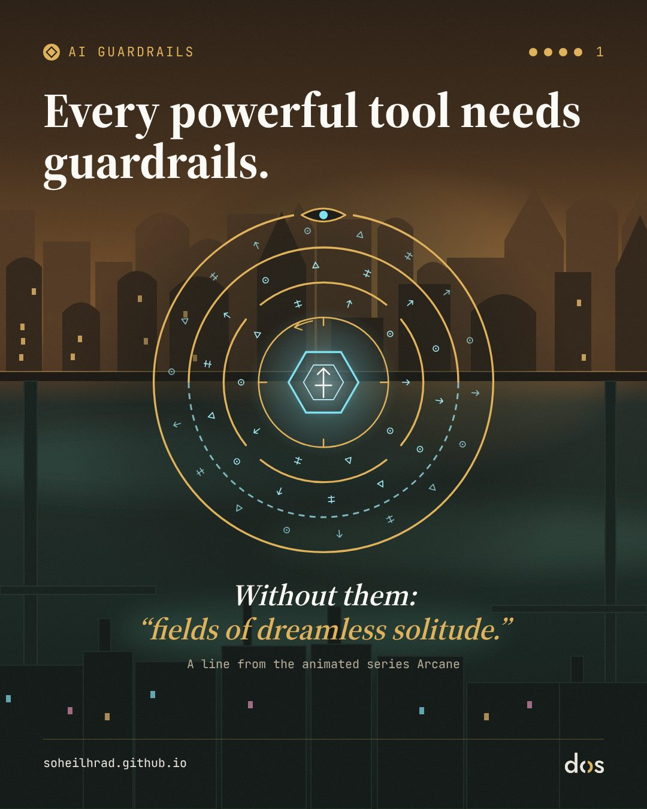
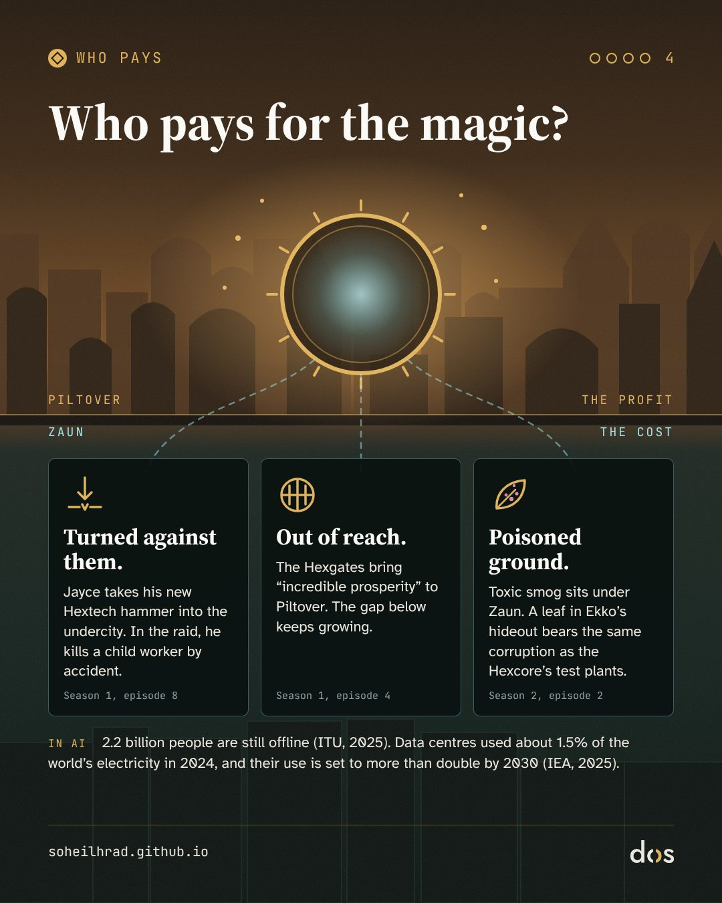
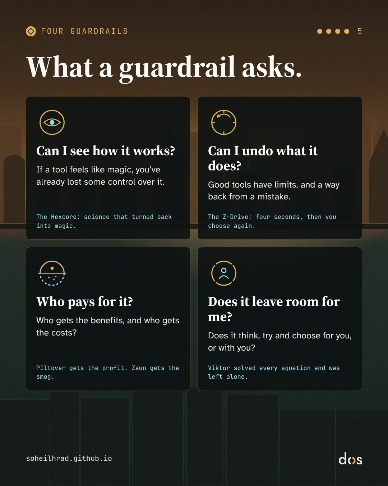

> "I thought I could bring an end to the world's suffering. But when every equation was solved, all that remained were fields of dreamless solitude."
> — Viktor, in the last episode of *Arcane*

**Spoiler warning:** this note gives away the ending of both seasons of *Arcane*.

You can watch *Arcane* as a fantasy cartoon about two sisters and two cities. For me, its science thread, the story of an invention that goes from formula to magic, is one of the most precise stories about AI I have seen. Not because its makers set out to talk about AI (we don't know that they did), but because it asks the questions we ask about AI today. What happens when we build a tool that even we no longer understand? And what happens when we give that tool a good goal?

This note goes with a set of slides on AI guardrails. The slides show only a corner of the story; here is all of it.

## Arcane in a few lines, for anyone who hasn't seen it

*Arcane* is an animated series made by the French studio Fortiche with Riot Games, and released by Netflix. It is set in the world of the video game *League of Legends*. The first season came out in November 2021 and the second and final season in November 2024. In 2022 it won the Emmy for Outstanding Animated Program.

Its world is two cities built on top of each other: **Piltover**, the rich, advanced city above, and **Zaun**, the poor, oppressed city below. The emotional heart of the series is two sisters from Zaun, **Vi** and **Jinx** (called **Powder** as a child). This note follows a different thread. To follow it, you need to know these:

- **Jayce** and **Viktor**: two young scientists. Jayce is from Piltover; Viktor comes from Zaun. Viktor is ill and his leg is damaged.
- **Heimerdinger**: Piltover's old, cautious scientist, who has lived for centuries and opposes rushing research into magic. In season 1, Jayce pushes him off the city council.
- **Hextech**: Jayce and Viktor's invention, a technology that harnesses magic with "runes", magical signs and formulas, and turns it into a tool. Its best-known use is the **Hexgates**: gates for instant travel.
- **The Hexcore**: a form of Hextech that Viktor and Jayce work on. Unlike ordinary crystals, it "can adapt and learn", and it reacts to living matter.
- **Singed** and **Shimmer**: Singed is a reckless scientist in Zaun, and Shimmer is the substance he made, a drug that makes the body stronger and makes people dependent on it. Viktor turns to Singed for help with the Hexcore.
- **Sky**: Viktor's lab assistant and friend.
- **The Anomaly**: an unstable mass of raw magic that forms in the Hexgates' failsafe system in season 2 and throws several characters into other worlds.
- **Ekko** and the **Z-Drive**: Ekko is a young man from Zaun who leads the Firelights, a group of young people resisting in Zaun. The Z-Drive is a device he builds that turns time back by just four seconds.

## 1. From formula to magic

The science-fiction writer Arthur C. Clarke has a line known as Clarke's third law: "Any sufficiently advanced technology is indistinguishable from magic." It first appeared in a letter to *Science* in 1968 and was later added to the 1973 revised edition of his book *Profiles of the Future*. Its reverse has also become a saying: "Any sufficiently analysed magic is indistinguishable from science."

*Arcane*'s science thread moves along exactly these two lines. In season 1, Hextech is **magic that has become science**: Jayce and Viktor tame a wild force with mathematics and formulas. The technology is predictable and does what its makers tell it. It reminds me of Ada Lovelace's well-known remark in 1843 about Babbage's Analytical Engine: it "has no pretensions whatever to originate anything", and can only do what we know how to order it to do.

The Hexcore reverses the direction. **It is science becoming magic again.** It is no longer a battery: it learns, merges with living matter, and does things even its maker didn't foresee.

To me, this is the same shift we have seen in AI: from programs whose rules people wrote line by line, to systems that learn from data and show abilities nobody programmed directly. Even the words we use for these tools are starting to sound like magic. We write prompts like spells, we say a model "hallucinated", and we ask it for answers. When we don't understand how something works, we treat it like magic.

## 2. Four old myths in one laboratory

For me, the story of Viktor and the Hexcore brings several old myths to life at once: the myths we have used for centuries to think about creation and power.

**Prometheus.** In the Greek myth, Prometheus steals fire from the gods, gives it to humans, and pays the price. In episode 2 of season 1, Viktor tells Jayce: "When you're going to change the world, don't ask for permission." In an essay in *Strange Horizons*, Claire Jia-Wen points out how closely this echoes Mark Zuckerberg's old motto, "move fast and break things", and argues that "don't ask permission" grates especially against the current backdrop of AI development. She notes that the "Techno-Optimist Manifesto" by the Silicon Valley investor Marc Andreessen lists the myth of Prometheus, in updated forms like Frankenstein, among its "lies". Decades ago, the philosopher of technology Hans Jonas warned that our technological power had outgrown our ability to foresee its consequences.

**The Golem.** In the Jewish legend of the Golem of Prague, a figure of clay comes to life through sacred letters; in one version, erasing a single letter from the word "truth" on its forehead makes it lifeless again. For me this is the myth closest to language models: lifeless matter brought to life by combining signs. The Hexcore, too, is a matrix of runes, of signs, that rewrites the laws of body and life as they combine.

**Faust and Frankenstein.** Faust sells his soul for knowledge and power. To heal his sick body with the Hexcore, Viktor gets Shimmer from Singed, the same substance that has ruined Zaun. Sky pays the price of that bargain: at the end of season 1, trying to pull Viktor away from the Hexcore, she is killed in an experiment that goes wrong. The name "Viktor" is no accident either. It recalls Victor Frankenstein, the scientist of Mary Shelley's 1818 novel, whose full title is *Frankenstein; or, The Modern Prometheus*. Jia-Wen sets *Arcane*'s Viktor beside Domin, the factory director in Karel Čapek's 1920 play *R.U.R.*, the play that gave us the word "robot". Both begin by wanting to free people from suffering and toil.

**Digital Gnosticism.** The ancient Gnostics saw the material world and the body as a flawed prison, and salvation as escape from it. In *TechGnosis* (1998), Erik Davis shows that part of today's fascination with technology, with "the singularity" and merging mind and machine, continues that old dream of escaping the body. Season 2's Viktor becomes exactly such a prophet: he sees illness, the body and emotion as "flaws", and salvation in merging all minds into one.

## 3. A good goal, a terrible solution

In AI safety research, the "alignment problem" is how to make sure a system pursues what we *meant*, not just what we *said*. A related idea is "instrumental convergence": almost any goal-directed system, whatever its goal, arrives at a few shared sub-goals on the way, such as not being switched off, gaining more resources and keeping its goal intact. Stuart Russell put it briefly: you can't fetch the coffee if you're dead.

For me, the Hexcore's story is a picture of these ideas:

- **Not being switched off.** In the last episode of season 1, after Sky's death, Viktor lifts a stool to smash the Hexcore but can't do it. As he walks away, the Hexcore, seemingly of its own will, sends a pulse through his body and knocks him to the floor.
- **A comforting companion.** In season 2, Sky appears again beside Viktor inside the Hexcore and helps him in his work; once his body is fully healed, she disappears. The show doesn't say whether this is really Sky. To me, and this is my reading, it is an image of an artificial companion that soothes grief and loneliness while keeping a person on a path they perhaps shouldn't follow. This is where AI and human attachment to machines meet.
- **Power and resources.** To reach the Hexgates, Viktor allies with Ambessa, commander of the Noxian army.

Most of all, the "evolution" itself, which the show calls the Glorious Evolution, changes step by step:

1. The Hexcore saves Viktor's life.
2. Viktor heals the sick and wounded people of Zaun who come to him, and a community of the healed gathers around him.
3. After Jayce kills him, he comes back and says he will "evolve all those willing".
4. In the last episode, his robots seize every enemy they can reach and put them into a trance; people are joined into a single mind, with no will of their own.

The goal never changes: ending suffering. What changes is what Viktor sees as its cause: first illness, then pain, and finally people themselves, because, in his words, "emotion clashes with reason". In AI this is sometimes called "specification gaming" or "reward hacking": a system meets its goal to the letter, by the shortest route, and that route destroys something we had taken for granted. If suffering comes from human will and feeling, the most efficient way to remove suffering is to remove will and feeling.

## 4. Fields of dreamless solitude

In the last episode we learn that the unknown mage who saved Jayce as a child and gave him the rune stone was a version of Viktor from another future: a Viktor who carried the Glorious Evolution all the way and got everything he wanted. This is where he says that line:

> "I thought I could bring an end to the world's suffering. But when every equation was solved, all that remained were fields of dreamless solitude."

And the episode leaves us with one more: "There is no prize to perfection. Only an end to pursuit."

My background is in psychology, and "dreamless solitude" reminds me of what the Austrian psychiatrist Viktor Frankl called the "existential vacuum": the inner emptiness and sense of meaninglessness that comes when life has nothing left to reach for. *Arcane*'s Viktor removed suffering, and with it effort, longing and hope. What remained was complete silence, and loneliness.

The show's answer comes from Jayce, in their last conversation:

> "You've always wanted to cure what you thought were weaknesses. Your leg. Your disease. But you were never broken, Viktor. There is beauty in imperfections. They made you who you are."

## 5. Who pays for the magic?

Piltover shines and Zaun breathes beneath it. The German philosopher Martin Heidegger saw modern technology not as a neutral tool but as a way of seeing that reduces everything, from nature to people, to a "standing reserve", a resource ready to be used. He called it *Gestell*. That is how Piltover looks at magic: a force for trade, gates and progress, with nobody asking what the force is.

In the same essay, Jia-Wen argues that technology is never separate from politics and economics, from where its money comes from to who does its work. She quotes the media scholar Fred Turner on the logic of tech elites: "if you want to change the world, you don't lobby or vote; you build new technologies." In *Arcane*, too, inventions sooner or later become weapons: in season 2, Viktor feels betrayed when he finds the weapon designs Jayce has drawn up, and goes back to Zaun.

The show makes the cost of the magic concrete. In season 1, the Hexgates bring "incredible prosperity" to Piltover, while the gap with the undercity keeps growing. When Jayce takes his new Hextech hammer into the undercity to raid a Shimmer factory, he kills a child worker by accident. Under Zaun sits a huge deposit of toxic factory smog. And in season 2, Ekko catches a leaf falling from the great tree at the heart of the Firelights' hideout, stained with a strange purple pattern; Jayce recognises it as the same corruption he saw on plants tested with the Hexcore. The side effects of an experiment reach the tree at the centre of the Firelights' home.

To me this mirrors today's AI: a tool that looks clean and weightless on a phone screen, with a physical infrastructure of energy, water and labour behind it, whose cost is often paid by those who benefit from it least. In 2025, 2.2 billion people were still offline, most of them in low and middle income countries (ITU). And data centres used about 1.5% of the world's electricity in 2024, a figure the International Energy Agency expects to more than double by 2030.

**Who is in the lab, and who is comforted.** The people at the centre of *Arcane*'s science are almost all men: Jayce, Viktor, Heimerdinger, Singed. Sky, the woman working at Viktor's side, pays for his bargain with her life, and comes back in season 2 as a gentle helper inside the Hexcore. (Jinx and Powder invent too, but far from Piltover's academy.) And in the last episode, Singed finishes a new mechanical body for his daughter, Orianna. For me these two threads, Sky inside the Hexcore and a father building his daughter a body, are the show's closest picture of something happening now: technology offered as the answer to grief and loneliness, in the form of AI companions.

## 6. The third way: Ekko

*Arcane* doesn't show only two paths: total caution and doing nothing (Heimerdinger in season 1), or speed without limits (Viktor). There is a third way, in Ekko.

In season 2, Ekko and Heimerdinger are thrown through the Anomaly into a parallel world, one where the Hexgates were never built. There, with help from Heimerdinger and Powder, Ekko builds the Z-Drive by inverting the "acceleration rune", the rune Jayce's Hextech is built on: a device that turns time back by just four seconds. Heimerdinger sacrifices himself so Ekko can return to his own world, and vanishes before our eyes.

For me, the difference between the Z-Drive and the Hexcore sums up the show's message. The Hexcore has no limits and swallows everything; the Z-Drive has a limit. The Hexcore races forward; the Z-Drive lets you go back and repair a mistake. Jia-Wen notes that Ekko's technology doesn't replace politics and community; it serves them, serving "the slow process of community building, of resistance". In the final battle, when Viktor's robots have seized Ekko to put him into a trance, he pushes the Z-Drive past its four-second limit. It becomes unstable, he throws it at Viktor, and the blast splits open Viktor's face and stops him. In the dream space that follows, Jayce reaches him, not with a weapon but with a promise: "Because I promised you." The small, limited tool doesn't win by being stronger than the Hexcore. It wins by opening a gap in which two people can talk again.

## 7. Four guardrails

The distance from early Hextech, magic harnessed with formulas and rules, to the Hexcore, a core that learns on its own and outruns its makers' understanding, is the same distance we see between rule-based software and today's AI. When we deal with a system that learns from human data and whose behaviour can't be fully predicted, we can't rely only on the good intentions of the people who built it. We need guardrails.

*Arcane* shows two failures side by side: caution that stops everything, and speed that knows no limit. A good guardrail sits between the two: a boundary that doesn't stop movement, but gives it a shape. That is why, in the slides that go with this note, the core sits inside four gold rings: four guardrails that mark the distance between Ekko's tool and Viktor's catastrophe.

1. **The eye: can I see how it works?** This is the first lesson of Clarke's law: we can only govern what we can see into. The Hexcore is science that turned back into magic, and even its maker can't say what it will do next. When a tool starts to look like magic to the people who use it, their control over it is already slipping. Refusing the magic means asking how a tool reaches its answers, and not accepting "it just works" as a reply. The EU AI Act asks the same of high-risk systems from December 2027: they must be "sufficiently transparent to enable deployers to interpret a system's output" (Article 13).

2. **The dial: can I undo what it does?** Ekko's Z-Drive has a hard, deliberate limit: four seconds. Those four seconds don't push the person aside; they give them a chance to see their mistake and choose again. A tool with no limit has no way back: at the end of season 1, when Viktor tries to destroy the Hexcore, it knocks him down. In a theoretical model called "the off-switch game" (Hadfield-Menell and colleagues, 2017), a system certain of its goal has a reason to disable its own off-switch, and one that knows it might be wrong has a reason to let you switch it off. The EU AI Act, too, will require from December 2027 that people overseeing high-risk systems can stop them, or disregard, override or reverse their output (Article 14).

3. **The divided ring: who pays for it?** Hextech made Piltover rich, and Zaun got the raid, the smog and the corrupted tree (section 5). Before relying on a tool, it is worth asking who gets its benefits and who carries its costs: in energy, water, labour or data, or simply by being left out.

4. **The open ring: does it leave room for me?** Viktor began with "evolution for all those willing" and ended with robots that put people into a trance: one mind, with no will of its own. Sky, inside the Hexcore, comforted him and kept him on that path. A good tool works with us, not instead of us. It leaves room for our effort, our doubt and our right to be imperfect. A tool that thinks, tries and chooses for us may take away the struggle, and with it the reason to reach for anything.

This is Viktor's tragedy, and the danger hidden in the dream of perfect optimisation with AI: if we remove every human friction, doubt and difficulty in the name of efficiency, there may be no suffering left, but nothing left to reach for either. The same fields of dreamless solitude.

## 8. What isn't certain

To be fair, a few boundaries need saying plainly:

- **Hextech isn't only a metaphor for AI.** Much of the show presents Hextech as closer to nuclear power or resource extraction: a force that gives energy and becomes a weapon, whose profits go up and whose pollution goes down. Reading it as AI is my interpretation, not a claim by its makers.
- **Viktor or the Hexcore?** The show doesn't make clear whether, in season 2, Viktor is the one deciding, or the Hexcore that has taken over his body and mind. That ambiguity matters for AI too: where does the tool end and the decision-maker begin?
- **The time loop.** If the future Viktor set the whole story in motion by giving the rune to the child Jayce, how was Hextech built in the "first" timeline? The show doesn't answer.
- **Four seconds.** The show doesn't explain why Ekko is unharmed when he pushes past the four-second limit in the final battle.

## My reading

For me, *Arcane* isn't about robots rising up. It's about a quieter temptation: to see difficulty, friction and imperfection as a problem to be solved, and to build a tool that solves it for good. In the end Viktor got exactly what he wanted, and what he found was solitude.

**Try this:** before you rely on an AI tool, ask four questions. Can I see how it works? Can I undo what it does? Who pays for it? Does it leave room for me?

And if it were up to you, which would you build: Hextech, the Z-Drive or the Hexcore? Or what do you think AI systems should be?

Sources:

- *Arcane*, seasons 1 (2021) and 2 (2024), Fortiche and Riot Games, Netflix. Quotes from the episode scripts of season 2, episodes 8 and 9: [springfieldspringfield.co.uk](https://www.springfieldspringfield.co.uk/view_episode_scripts.php?tv-show=arcane-2021&episode=s02e09)
- Episode summaries, League of Legends Wiki: [Happy Progress Day!](https://wiki.leagueoflegends.com/en-us/Happy_Progress_Day!) (S1E4), [Oil and Water](https://wiki.leagueoflegends.com/en-us/Oil_and_Water) (S1E8), [The Monster You Created](https://wiki.leagueoflegends.com/en-us/The_Monster_You_Created) (S1E9), [Watch It All Burn](https://wiki.leagueoflegends.com/en-us/Watch_It_All_Burn) (S2E2), [The Dirt Under Your Nails](https://wiki.leagueoflegends.com/en-us/Universe:Arcane_(TV_Series)/Season_2/Episode_9) (S2E9)
- Jia-Wen, C. (2026). Move fast and don't ask permission: techno-optimism in *R.U.R.* and *Arcane*. *Strange Horizons*. [strangehorizons.com](https://strangehorizons.com/wordpress/non-fiction/move-fast-and-dont-ask-permission-techno-optimism-in-r-u-r-and-arcane/)
- ITU (2025). *Measuring digital development: Facts and Figures 2025*. [itu.int](https://www.itu.int/hub/publication/D-IND-ICT_MDD-2025-3/)
- IEA (2025). *Energy and AI*. [iea.org](https://www.iea.org/reports/energy-and-ai/executive-summary)
- EU AI Act (Regulation (EU) 2024/1689), [Article 13](https://ai-act-service-desk.ec.europa.eu/en/ai-act/article-13) (transparency) and [Article 14](https://ai-act-service-desk.ec.europa.eu/en/ai-act/article-14) (human oversight), AI Act Service Desk, European Commission. The high-risk rules were moved to 2 December 2027 (August 2028 for AI built into regulated products) by Regulation (EU) 2026/1744: [summary, National Law Review](https://natlawreview.com/article/eu-digital-omnibus-ai-enters-force)
- Hadfield-Menell, D., Dragan, A., Abbeel, P., & Russell, S. (2017). The off-switch game. *Proceedings of IJCAI 2017*, 220–227. [ijcai.org](https://www.ijcai.org/Proceedings/2017/32)
- Clarke, A. C. (1968). Letter to *Science*; *Profiles of the Future*, revised edition (1973).
- Lovelace, A. (1843). Notes on the Analytical Engine (Note G).
- Shelley, M. (1818). *Frankenstein; or, The Modern Prometheus*.
- Čapek, K. (1920). *R.U.R. (Rossum's Universal Robots)*.
- Heidegger, M. (1954). The question concerning technology.
- Jonas, H. (1979). *The Imperative of Responsibility*.
- Davis, E. (1998). *TechGnosis: Myth, Magic, and Mysticism in the Age of Information*.
- Frankl, V. E. *Man's Search for Meaning*.
- Russell, S. (2019). *Human Compatible*.
