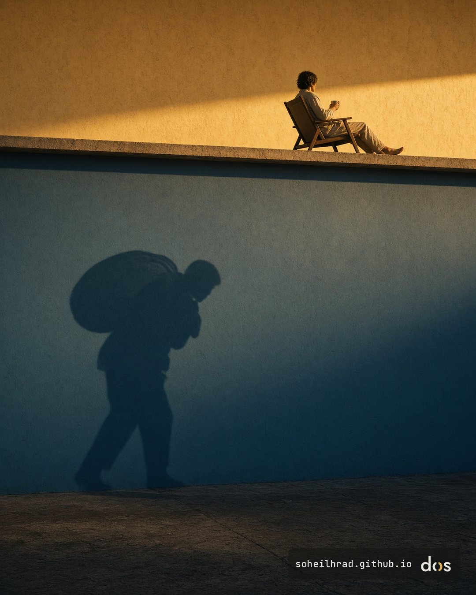

Lately one idea keeps circulating: that AI and robots will soon do so much of the work that working will become optional, and everyone will live on a high income. Others hear the opposite and are convinced we are doomed, that this technology will end us altogether.

Both stories are about a future that hasn't arrived yet. Humanitarian work has taught me to ask a different question first: who is already paying today, and who is left out of a promise before it is even kept?

Two billion people are still offline. Being online does not settle it either. Some of the best-known AI and cloud services are not offered at all in certain countries, some have been cut off there by sanctions, and an account opened from those places can be blocked. For many others, the price of a monthly subscription is simply out of reach.

Some of the new discrimination is harder to see. A 2023 study found that tools built to detect AI-written text kept flagging the writing of non-native English speakers as machine-made. The people wrongly flagged were the ones already working hardest to be understood in a language that isn't their own.

So when I hear that work will become optional, I see a world more divided and marginalised, where some people won't need to work while others carry the weight and pay the price.

I'm curious how this looks from where you are. Do you see it heading toward plenty, toward disaster, or toward a wider gap between people?

For further reading, my previous note looks at what guardrails AI tools need: [Fields of dreamless solitude](/blog/2026/11/dreamless-solitude/).

Sources:

- International Telecommunication Union (2026). *Measuring digital development: Facts and Figures 2026*. [itu.int/itu-d/reports/statistics/facts-figures-2026](https://www.itu.int/itu-d/reports/statistics/facts-figures-2026/)
- OpenAI. API supported countries and territories (accessed 12 November 2026): outside the listed countries the API is not supported, and access from there may get an account blocked or suspended. [help.openai.com/articles/5347006](https://help.openai.com/articles/5347006)
- GitHub. GitHub and trade controls: restrictions introduced in 2019 to comply with US sanctions, based on location and residence, not nationality. [docs.github.com](https://docs.github.com/en/site-policy/other-site-policies/github-and-trade-controls)
- Liang, W., Yuksekgonul, M., Mao, Y., Wu, E., & Zou, J. (2023). GPT detectors are biased against non-native English writers. *Patterns*, 4(7), 100779. [doi.org/10.1016/j.patter.2023.100779](https://doi.org/10.1016/j.patter.2023.100779)
- Center for AI Safety (2023). Statement on AI Risk: "Mitigating the risk of extinction from AI should be a global priority alongside other societal-scale risks such as pandemics and nuclear war." [safe.ai](https://www.safe.ai/press-release)
