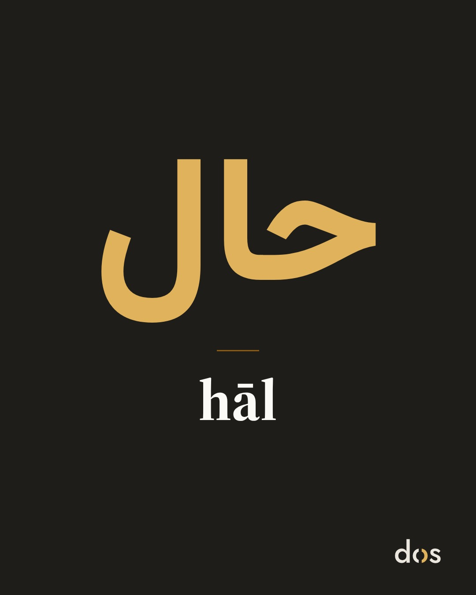

Many years ago I gave a presentation at Ferdowsi University of Mashhad, after finishing my thesis on Iranian dastgāh music and emotions. Afterwards, a woman came up to me and said she feels that all Iranian songs carry a special kind of sadness, one that belongs to this music and this geography.

Why she said that to me has stayed with me through the years.

I have my own answer, and it is not a scientific one. I think this sadness comes from how a people kept trying to hold on to its glory and its humanity in a harsh world. It does not sound like giving up. It sounds like someone who has been through a lot and is still standing.

One of the pieces from my study is [Ney Nava, by Hossein Alizadeh](https://open.spotify.com/track/4wfn8715AHkpf2ws6thquz) (2006, 4:17). Of all the excerpts, listeners rated it the saddest.

Rumi's Masnavi also begins with the ney: "Listen to the reed, how it complains."

<blockquote>

در نیابد حالِ پخته هیچ خام پس سخن کوتاه باید، والسلام

The raw cannot grasp the hāl of the ripe; so let the words be short.

</blockquote>

Now listen to Ney Nava; it takes about four minutes. And then: how is your hāl (حال)?

## Sources

- Alizadeh, H. (2006). Ney Nava / Darâmad. 4:17. [Spotify](https://open.spotify.com/track/4wfn8715AHkpf2ws6thquz)
- Rumi, J. *Masnavi*, Book 1, opening lines (the song of the reed). Persian text: [Ganjoor](https://ganjoor.net/t6e?p=7893). English renderings of the lines are mine.
