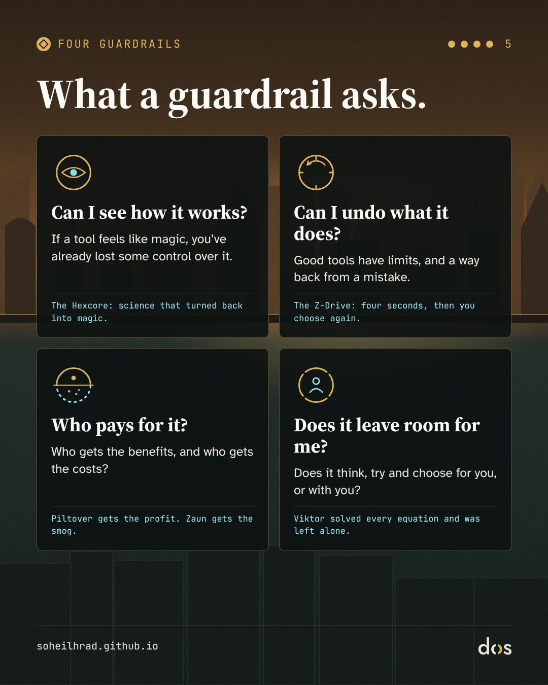

> «Pensé que podía poner fin al sufrimiento del mundo. Pero cuando cada ecuación quedó resuelta, solo quedaron campos de soledad sin sueños».
> — Viktor, en el último episodio de *Arcane* (traducción mía)

**Aviso de spoilers:** esta nota desvela el final de las dos temporadas de *Arcane*.

Puedes ver *Arcane* como una serie de animación fantástica sobre dos hermanas y dos ciudades. Para mí, su hilo científico, la historia de un invento que va de la fórmula a la magia, es uno de los relatos más precisos sobre la IA que he visto. No porque sus creadores quisieran hablar de IA (no sabemos si era su intención), sino porque plantea las mismas preguntas que hoy nos hacemos sobre la IA. ¿Qué pasa cuando construimos una herramienta que ni nosotros mismos entendemos? ¿Y qué pasa cuando le damos un buen objetivo?

Esta nota acompaña a una serie de diapositivas sobre los límites de seguridad de la IA. Las diapositivas solo muestran una parte de la historia; aquí la cuento entera.

## Arcane en pocas líneas, para quien no la haya visto

*Arcane* es una serie de animación del estudio francés Fortiche con Riot Games, estrenada en Netflix. Transcurre en el mundo del videojuego *League of Legends*. La primera temporada se estrenó en noviembre de 2021, y la segunda y última, en noviembre de 2024. En 2022 ganó el Emmy al mejor programa de animación.

Su mundo son dos ciudades construidas una encima de la otra: **Piltover**, la ciudad rica y avanzada de arriba, y **Zaun**, la ciudad pobre y oprimida de abajo. El corazón de la serie son dos hermanas de Zaun, **Vi** y **Jinx** (que de niña se llamaba **Powder**). Pero esta nota sigue otro hilo. Para seguirlo, basta con conocer a estos:

- **Jayce** y **Viktor**: dos científicos jóvenes. Jayce es de Piltover; Viktor viene de Zaun. Viktor está enfermo y tiene una pierna dañada.
- **Heimerdinger**: el científico anciano y prudente de Piltover, que lleva siglos vivo y se opone a investigar la magia con prisas. En la primera temporada, Jayce lo aparta del consejo de la ciudad.
- **Hextech**: el invento de Jayce y Viktor, una tecnología que doma la magia con «runas», signos y fórmulas mágicas, y la convierte en herramienta. Su uso más conocido son los **Hexgates**: puertas para viajar al instante.
- **El Hexcore**: una forma de Hextech en la que trabajan Viktor y Jayce. A diferencia de los cristales normales, «puede adaptarse y aprender», y reacciona a la materia viva.
- **Singed** y el **Shimmer**: Singed es un científico temerario de Zaun, y el Shimmer, la sustancia que creó: una droga que fortalece el cuerpo y engancha a quien la toma. Viktor recurre a Singed para trabajar con el Hexcore.
- **Sky**: ayudante de laboratorio y amiga de Viktor.
- **La Anomalía**: una masa inestable de magia en bruto que se forma en el sistema de seguridad de los Hexgates en la segunda temporada y lanza a varios personajes a otros mundos.
- **Ekko** y el **Z-Drive**: Ekko es un joven de Zaun que lidera a los Firelights, un grupo de jóvenes de la resistencia de Zaun. El Z-Drive es un aparato que construye y que hace retroceder el tiempo solo cuatro segundos.

## 1. De la fórmula a la magia

El escritor de ciencia ficción Arthur C. Clarke tiene una frase conocida como la tercera ley de Clarke: «Cualquier tecnología lo bastante avanzada es indistinguible de la magia». Apareció por primera vez en una carta a la revista *Science* en 1968 y después se añadió a la edición revisada de 1973 de su libro *Perfiles del futuro*. Su inversa también se ha vuelto un dicho: «Cualquier magia lo bastante analizada es indistinguible de la ciencia».

El hilo científico de *Arcane* avanza justo sobre estas dos frases. En la primera temporada, el Hextech es **magia que se ha vuelto ciencia**: Jayce y Viktor doman una fuerza salvaje con matemáticas y fórmulas. La tecnología es predecible y obedece a quien la crea. Me recuerda la famosa observación de Ada Lovelace en 1843 sobre la máquina analítica de Babbage: «no tiene pretensión alguna de originar nada» y solo puede hacer lo que sepamos ordenarle.

El Hexcore invierte la dirección. **Es ciencia que vuelve a ser magia.** Ya no es una batería: aprende, se mezcla con la materia viva y hace cosas que ni siquiera su creador había previsto.

Para mí, es el mismo paso que hemos visto en la IA: de programas cuyas reglas escribía una persona línea a línea, a sistemas que aprenden de los datos y muestran capacidades que nadie programó directamente. Hasta las palabras que usamos para estas herramientas empiezan a sonar a magia. Escribimos «prompts» como conjuros, decimos que un modelo «alucinó» y le pedimos respuestas. Cuando no entendemos cómo funciona algo, lo tratamos como magia.

## 2. Cuatro mitos antiguos en un mismo laboratorio

Para mí, la historia de Viktor y el Hexcore da vida a la vez a varios mitos antiguos: los que llevamos siglos usando para pensar en la creación y el poder.

**Prometeo.** En el mito griego, Prometeo roba el fuego a los dioses, se lo da a los humanos y paga el precio. En el segundo episodio de la primera temporada, Viktor le dice a Jayce: «Cuando vas a cambiar el mundo, no pides permiso». En un ensayo en *Strange Horizons*, Claire Jia-Wen señala cuánto recuerda esto al viejo lema de Mark Zuckerberg, «muévete rápido y rompe cosas», y sostiene que el «no pidas permiso» chirría especialmente en el contexto actual del desarrollo de la IA. Recuerda que el «Manifiesto tecno-optimista» del inversor de Silicon Valley Marc Andreessen incluye el mito de Prometeo, en versiones modernas como Frankenstein, entre sus «mentiras». Hace décadas, el filósofo de la tecnología Hans Jonas advirtió que nuestro poder tecnológico había superado nuestra capacidad de prever sus consecuencias.

**El Golem.** En la leyenda judía del Golem de Praga, una figura de barro cobra vida gracias a unas letras sagradas; en una de las versiones, basta con borrar una letra de la palabra «verdad» en su frente para que vuelva a quedar sin vida. Para mí, es el mito más cercano a los modelos de lenguaje: materia inerte que cobra vida al combinar signos. El Hexcore también es una matriz de runas, es decir, de signos, que al combinarse reescriben las leyes del cuerpo y de la vida.

**Fausto y Frankenstein.** Fausto vende su alma a cambio de conocimiento y poder. Para curar su cuerpo enfermo con el Hexcore, Viktor consigue Shimmer de Singed, la misma sustancia que ha arruinado Zaun. Sky paga el precio de ese trato: al final de la primera temporada, al intentar separar a Viktor del Hexcore, muere en un experimento que sale mal. El nombre de Viktor tampoco es casual. Recuerda a Victor Frankenstein, el científico de la novela de Mary Shelley de 1818, cuyo título completo es *Frankenstein o el moderno Prometeo*. Jia-Wen sitúa al Viktor de *Arcane* junto a Domin, el director de la fábrica en la obra de Karel Čapek *R.U.R.* (1920), la que nos dio la palabra «robot». Los dos empiezan queriendo liberar a la gente del sufrimiento y del trabajo.

**El gnosticismo digital.** Los antiguos gnósticos veían el mundo material y el cuerpo como una prisión defectuosa, y la salvación como la huida de ella. En *TechGnosis* (1998), Erik Davis muestra que parte de la fascinación actual por la tecnología, por «la singularidad» y por fundir mente y máquina, continúa ese viejo sueño de escapar del cuerpo. El Viktor de la segunda temporada se convierte justo en ese profeta: ve la enfermedad, el cuerpo y la emoción como «defectos», y la salvación en fundir todas las mentes en una.

## 3. Un buen objetivo, una solución terrible

En la investigación sobre seguridad de la IA, el «problema de la alineación» consiste en asegurarse de que un sistema persiga lo que *queríamos decir*, no solo lo que *dijimos*. Una idea relacionada es la «convergencia instrumental»: casi cualquier sistema orientado a un objetivo, sea cual sea ese objetivo, llega por el camino a unos cuantos subobjetivos comunes, como que no lo apaguen, conseguir más recursos y mantener intacto su objetivo. Stuart Russell lo resumió así: no puedes traer el café si estás muerto.

Para mí, la historia del Hexcore es una imagen de estas ideas:

- **Que no lo apaguen.** En el último episodio de la primera temporada, tras la muerte de Sky, Viktor levanta un taburete para destrozar el Hexcore, pero no es capaz. Cuando se aleja, el Hexcore, aparentemente por voluntad propia, le lanza una onda que lo tira al suelo.
- **Una compañía que consuela.** En la segunda temporada, Sky vuelve a aparecer junto a Viktor dentro del Hexcore y le ayuda en su trabajo; cuando el cuerpo de Viktor se cura del todo, desaparece. La serie no dice si de verdad es Sky. Para mí, y esta es mi lectura, es la imagen de una compañía artificial que alivia el duelo y la soledad y, a la vez, mantiene a alguien en un camino que quizá no debería seguir. Aquí es donde se encuentran la IA y el apego humano a las máquinas.
- **Poder y recursos.** Para llegar a los Hexgates, Viktor se alía con Ambessa, comandante del ejército noxiano.

Y, sobre todo, la propia «evolución», que la serie llama la Gloriosa Evolución, cambia paso a paso:

1. El Hexcore le salva la vida a Viktor.
2. Viktor cura a los enfermos y heridos de Zaun que acuden a él, y a su alrededor se forma una comunidad de curados.
3. Después de que Jayce lo mate, vuelve y dice que hará evolucionar «a todos los que quieran».
4. En el último episodio, sus robots atrapan a todos los enemigos que alcanzan y los sumen en un trance; las personas quedan unidas en una sola mente, sin voluntad propia.

El objetivo nunca cambia: acabar con el sufrimiento. Lo que cambia es dónde ve Viktor su causa: primero la enfermedad, luego el dolor y, al final, las propias personas, porque, en sus palabras, «la emoción choca con la razón». En IA a esto a veces se le llama «juego con la especificación» (specification gaming) o «hackeo de la recompensa»: un sistema cumple su objetivo al pie de la letra, por el camino más corto, y ese camino destruye algo que dábamos por sentado. Si el sufrimiento viene de la voluntad y del sentimiento humanos, la forma más eficiente de eliminar el sufrimiento es eliminar la voluntad y el sentimiento.

## 4. Campos de soledad sin sueños

En el último episodio descubrimos que el mago desconocido que salvó a Jayce de niño y le dio la piedra rúnica era una versión de Viktor de otro futuro: un Viktor que llevó la Gloriosa Evolución hasta el final y consiguió todo lo que quería. Aquí es donde dice esa frase:

> «Pensé que podía poner fin al sufrimiento del mundo. Pero cuando cada ecuación quedó resuelta, solo quedaron campos de soledad sin sueños». (traducción mía)

Y el episodio nos deja otra más: «La perfección no tiene premio. Solo el fin de la búsqueda». (traducción mía)

Mi formación es en psicología, y la «soledad sin sueños» me recuerda lo que el psiquiatra austriaco Viktor Frankl llamó el «vacío existencial»: el vacío interior y la sensación de sinsentido que llegan cuando la vida ya no tiene nada que alcanzar. El Viktor de *Arcane* eliminó el sufrimiento y, con él, el esfuerzo, el anhelo y la esperanza. Lo que quedó fue un silencio absoluto, y soledad.

La respuesta de la serie llega de boca de Jayce, en su última conversación:

> «Siempre quisiste curar lo que creías que eran debilidades. Tu pierna. Tu enfermedad. Pero nunca estuviste roto, Viktor. Hay belleza en las imperfecciones. Te hicieron quien eres». (traducción mía)

## 5. ¿Quién paga la magia?

Piltover brilla y Zaun respira bajo sus pies. El filósofo alemán Martin Heidegger no veía la tecnología moderna como una herramienta neutral, sino como una forma de mirar que reduce todo, de la naturaleza a las personas, a «existencias», un recurso listo para usarse. La llamó *Gestell*. Así mira Piltover la magia: una fuerza para el comercio, las puertas y el progreso, sin que nadie pregunte qué es esa fuerza.

En el mismo ensayo, Jia-Wen sostiene que la tecnología nunca está separada de la política y la economía, desde de dónde sale su dinero hasta quién hace su trabajo. Cita al investigador de medios Fred Turner sobre la lógica de las élites tecnológicas: «si quieres cambiar el mundo, no haces lobby ni votas; construyes nuevas tecnologías». En *Arcane*, también, los inventos tarde o temprano se convierten en armas: en la segunda temporada, Viktor se siente traicionado al encontrar los diseños de armas que ha dibujado Jayce, y vuelve a Zaun.

La serie hace muy concreto el coste de la magia. En la primera temporada, los Hexgates traen una «prosperidad increíble» a Piltover, mientras la brecha con la ciudad de abajo no deja de crecer. Cuando Jayce baja con su nuevo martillo Hextech a la ciudad de abajo para asaltar una fábrica de Shimmer, mata sin querer a un niño que trabaja allí. Bajo Zaun se acumula una enorme masa de humo tóxico de las fábricas. Y en la segunda temporada, Ekko atrapa una hoja que cae del gran árbol en el centro del refugio de los Firelights, manchada con un extraño dibujo morado; Jayce la reconoce: es la misma corrupción que vio en las plantas con las que se probó el Hexcore. Los efectos secundarios de un experimento llegan al árbol alrededor del cual viven los Firelights.

Para mí, esto es un espejo de la IA actual: una herramienta que parece limpia e ingrávida en la pantalla del móvil, con una infraestructura física de energía, agua y trabajo detrás, cuyo coste suelen pagar quienes menos se benefician de ella. En 2025, 2200 millones de personas seguían sin conexión a internet, la mayoría en países de ingresos bajos y medios (UIT). Y los centros de datos consumieron alrededor del 1,5 % de la electricidad mundial en 2024, una cifra que la Agencia Internacional de la Energía espera que se duplique con creces de aquí a 2030.

**Quién está en el laboratorio y quién recibe consuelo.** Las personas en el centro de la ciencia de *Arcane* son casi todas hombres: Jayce, Viktor, Heimerdinger, Singed. Sky, la mujer que trabaja junto a Viktor, paga su trato con la vida y vuelve en la segunda temporada como una ayudante amable dentro del Hexcore. (Jinx y Powder también inventan, pero lejos de la academia de Piltover). Y en el último episodio, Singed termina un nuevo cuerpo mecánico para su hija, Orianna. Para mí, estos dos hilos, Sky dentro del Hexcore y un padre que construye un cuerpo para su hija, son la imagen más cercana que ofrece la serie de algo que ya está pasando: la tecnología ofrecida como respuesta al duelo y la soledad, en forma de compañías de IA.

## 6. La tercera vía: Ekko

*Arcane* no muestra solo dos caminos: la prudencia total y no hacer nada (Heimerdinger en la primera temporada), o la velocidad sin límites (Viktor). Hay una tercera vía, en Ekko.

En la segunda temporada, Ekko y Heimerdinger son lanzados a través de la Anomalía a un mundo paralelo, uno en el que los Hexgates nunca se construyeron. Allí, con ayuda de Heimerdinger y Powder, Ekko construye el Z-Drive invirtiendo la «runa de la aceleración», la runa sobre la que se basa el Hextech de Jayce: un aparato que hace retroceder el tiempo solo cuatro segundos. Heimerdinger se sacrifica para que Ekko pueda volver a su mundo, y desaparece ante nuestros ojos.

Para mí, la diferencia entre el Z-Drive y el Hexcore resume el mensaje de la serie. El Hexcore no tiene límites y se lo traga todo; el Z-Drive tiene un límite. El Hexcore corre hacia delante; el Z-Drive te deja volver atrás y reparar un error. Jia-Wen señala que la tecnología de Ekko no sustituye a la política ni a la comunidad; está a su servicio, al servicio de «el lento proceso de construir comunidad, de resistencia». En la batalla final, cuando los robots de Viktor han atrapado a Ekko para sumirlo en el trance, él fuerza el Z-Drive más allá de su límite de cuatro segundos. El aparato se vuelve inestable, Ekko se lo lanza a Viktor y la explosión le abre la cara y lo detiene. En el espacio onírico que viene después, Jayce llega hasta él, no con un arma sino con una promesa: «Porque te lo prometí». La herramienta pequeña y limitada no gana por ser más fuerte que el Hexcore. Gana porque abre un hueco en el que dos personas pueden volver a hablar.

## 7. Cuatro límites de seguridad

La distancia entre el primer Hextech, magia domada con fórmulas y reglas, y el Hexcore, un núcleo que aprende solo y deja atrás lo que entienden sus creadores, es la misma que vemos entre el software basado en reglas y la IA actual. Cuando tratamos con un sistema que aprende de datos humanos y cuyo comportamiento no se puede predecir del todo, no podemos fiarnos solo de las buenas intenciones de quienes lo construyeron. Necesitamos límites de seguridad.

*Arcane* muestra dos fracasos uno al lado del otro: una prudencia que lo paraliza todo y una velocidad que no conoce límites. Un buen límite de seguridad está entre los dos: una frontera que no detiene el movimiento, sino que le da forma. Por eso, en las diapositivas que acompañan a esta nota, el núcleo está dentro de cuatro anillos dorados: cuatro preguntas que marcan la distancia entre la herramienta de Ekko y la catástrofe de Viktor.

1. **El ojo: ¿puedo ver cómo funciona?** Es la primera lección de la ley de Clarke: solo podemos gobernar lo que podemos ver por dentro. El Hexcore es ciencia que volvió a ser magia, y ni siquiera su creador sabe qué hará después. Cuando una herramienta empieza a parecer magia a quienes la usan, el control sobre ella ya se les está escapando. Rechazar la magia significa preguntar cómo llega una herramienta a sus respuestas, y no aceptar «simplemente funciona» como respuesta. La Ley de IA de la UE pide lo mismo a los sistemas de alto riesgo a partir de diciembre de 2027: deben ser «suficientemente transparentes» para que quienes los despliegan puedan interpretar sus resultados (artículo 13).

2. **El dial: ¿puedo deshacer lo que hace?** El Z-Drive de Ekko tiene un límite duro y deliberado: cuatro segundos. Esos cuatro segundos no apartan a la persona; le dan la oportunidad de ver su error y volver a elegir. Una herramienta sin límite no tiene vuelta atrás: al final de la primera temporada, cuando Viktor intenta destruir el Hexcore, este lo derriba. En un modelo teórico llamado «el juego del interruptor de apagado» (Hadfield-Menell y colegas, 2017), un sistema seguro de su objetivo tiene motivos para desactivar su propio interruptor, y uno que sabe que puede equivocarse tiene motivos para dejar que lo apagues. La Ley de IA de la UE también exigirá, a partir de diciembre de 2027, que quienes supervisan sistemas de alto riesgo puedan detenerlos, o ignorar, anular o revertir sus resultados (artículo 14).

3. **El anillo partido: ¿quién lo paga?** El Hextech hizo rica a Piltover, y a Zaun le tocaron el asalto, el humo y el árbol corrompido (sección 5). Antes de confiar en una herramienta, vale la pena preguntar quién se lleva sus beneficios y quién carga con sus costes: en energía, agua, trabajo o datos, o simplemente quedándose fuera.

4. **El anillo abierto: ¿me deja espacio?** Viktor empezó con «evolución para todos los que quieran» y acabó con robots que sumen a la gente en un trance: una sola mente, sin voluntad propia. Sky, dentro del Hexcore, lo consolaba y lo mantenía en ese camino. Una buena herramienta trabaja con nosotros, no en nuestro lugar. Deja espacio para nuestro esfuerzo, nuestras dudas y nuestro derecho a ser imperfectos. Una herramienta que piensa, intenta y elige por nosotros puede quitarnos la lucha y, con ella, el motivo para aspirar a nada.

Esta es la tragedia de Viktor, y el peligro escondido en el sueño de la optimización perfecta con IA: si eliminamos toda fricción, duda y dificultad humanas en nombre de la eficiencia, puede que ya no quede sufrimiento, pero tampoco quedará nada a lo que aspirar. Los mismos campos de soledad sin sueños.

## 8. Lo que no es seguro

Por honestidad, conviene decir claramente algunos límites:

- **El Hextech no es solo una metáfora de la IA.** Buena parte de la serie lo presenta más bien como la energía nuclear o la extracción de recursos: una fuerza que da energía y se convierte en arma, cuyos beneficios suben y cuya contaminación baja. Leerlo como IA es mi interpretación, no algo que afirmen sus creadores.
- **¿Viktor o el Hexcore?** La serie no deja claro si, en la segunda temporada, es Viktor quien decide o el Hexcore que ha tomado su cuerpo y su mente. Esa ambigüedad también importa para la IA: ¿dónde termina la herramienta y dónde empieza quien decide?
- **El bucle temporal.** Si el Viktor del futuro puso en marcha toda la historia al darle la runa a Jayce de niño, ¿cómo se construyó el Hextech en la «primera» línea temporal? La serie no lo responde.
- **Cuatro segundos.** La serie no explica por qué Ekko sale ileso al pasar del límite de cuatro segundos en la batalla final.

## Mi lectura

Para mí, *Arcane* no trata de robots que se rebelan. Trata de una tentación más callada: ver la dificultad, la fricción y la imperfección como un problema que hay que resolver, y construir una herramienta que lo resuelva para siempre. Al final, Viktor consiguió exactamente lo que quería, y lo que encontró fue soledad.

**Prueba esto:** antes de confiar en una herramienta de IA, hazte cuatro preguntas. ¿Puedo ver cómo funciona? ¿Puedo deshacer lo que hace? ¿Quién lo paga? ¿Me deja espacio?

Y si dependiera de ti, ¿cuál construirías: el Hextech, el Z-Drive o el Hexcore? ¿O cómo crees que deberían ser los sistemas de IA?

Fuentes (en inglés):

- *Arcane*, temporadas 1 (2021) y 2 (2024), Fortiche y Riot Games, Netflix. Citas traducidas de los guiones de los episodios 8 y 9 de la segunda temporada: [springfieldspringfield.co.uk](https://www.springfieldspringfield.co.uk/view_episode_scripts.php?tv-show=arcane-2021&episode=s02e09)
- Resúmenes de episodios, League of Legends Wiki: [Happy Progress Day!](https://wiki.leagueoflegends.com/en-us/Happy_Progress_Day!) (T1E4), [Oil and Water](https://wiki.leagueoflegends.com/en-us/Oil_and_Water) (T1E8), [The Monster You Created](https://wiki.leagueoflegends.com/en-us/The_Monster_You_Created) (T1E9), [Watch It All Burn](https://wiki.leagueoflegends.com/en-us/Watch_It_All_Burn) (T2E2), [The Dirt Under Your Nails](https://wiki.leagueoflegends.com/en-us/Universe:Arcane_(TV_Series)/Season_2/Episode_9) (T2E9)
- Jia-Wen, C. (2026). Move fast and don't ask permission: techno-optimism in *R.U.R.* and *Arcane*. *Strange Horizons*. [strangehorizons.com](https://strangehorizons.com/wordpress/non-fiction/move-fast-and-dont-ask-permission-techno-optimism-in-r-u-r-and-arcane/)
- UIT (2025). *Measuring digital development: Facts and Figures 2025*. [itu.int](https://www.itu.int/hub/publication/D-IND-ICT_MDD-2025-3/)
- AIE (2025). *Energy and AI*. [iea.org](https://www.iea.org/reports/energy-and-ai/executive-summary)
- Ley de IA de la UE (Reglamento (UE) 2024/1689), [artículo 13](https://ai-act-service-desk.ec.europa.eu/en/ai-act/article-13) (transparencia) y [artículo 14](https://ai-act-service-desk.ec.europa.eu/en/ai-act/article-14) (supervisión humana), AI Act Service Desk, Comisión Europea. El Reglamento (UE) 2026/1744 aplazó las normas de alto riesgo al 2 de diciembre de 2027 (agosto de 2028 para la IA integrada en productos regulados): [resumen, National Law Review](https://natlawreview.com/article/eu-digital-omnibus-ai-enters-force)
- Hadfield-Menell, D., Dragan, A., Abbeel, P., & Russell, S. (2017). The off-switch game. *Proceedings of IJCAI 2017*, 220–227. [ijcai.org](https://www.ijcai.org/Proceedings/2017/32)
- Clarke, A. C. (1968). Carta a *Science*; *Profiles of the Future*, edición revisada (1973).
- Lovelace, A. (1843). Notes on the Analytical Engine (Nota G).
- Shelley, M. (1818). *Frankenstein; or, The Modern Prometheus*.
- Čapek, K. (1920). *R.U.R. (Rossum's Universal Robots)*.
- Heidegger, M. (1954). The question concerning technology.
- Jonas, H. (1979). *The Imperative of Responsibility*.
- Davis, E. (1998). *TechGnosis: Myth, Magic, and Mysticism in the Age of Information*.
- Frankl, V. E. *Man's Search for Meaning*.
- Russell, S. (2019). *Human Compatible*.
