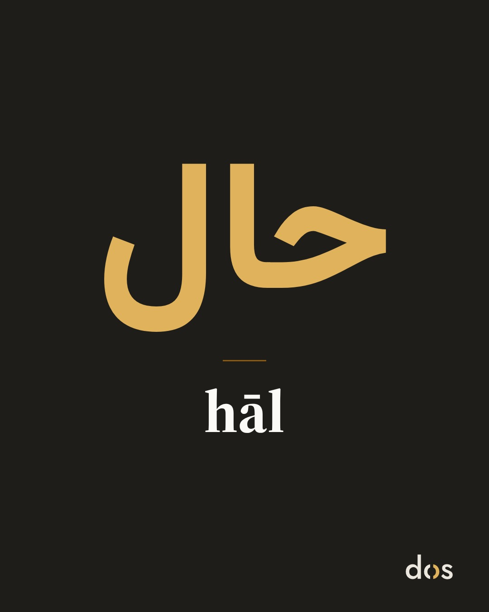

Hace muchos años di una presentación en la Universidad Ferdowsi de Mashhad, después de terminar mi tesis sobre la música dastgāh iraní y las emociones. Al terminar, una mujer se me acercó y me dijo que sentía que todas las canciones iraníes tienen una tristeza especial, una que pertenece a esta música y a esta geografía.

Por qué me lo dijo a mí se ha quedado conmigo todos estos años.

Tengo mi propia respuesta, y no es científica. Creo que esta tristeza nace de cómo un pueblo ha intentado conservar su grandeza y su humanidad en un mundo duro. No suena a rendición. Suena a alguien que ha pasado por mucho y sigue en pie.

Una de las piezas de mi estudio es [Ney Nava, de Hossein Alizadeh](https://open.spotify.com/track/4wfn8715AHkpf2ws6thquz) (2006, 4:17). De todos los fragmentos, los oyentes la calificaron como la más triste.

El Masnavi de Rumi también empieza con el ney: «Escucha la caña, cómo se queja». El verso dieciocho de ese comienzo dice:

<blockquote>

در نیابد حالِ پخته هیچ خام پس سخن کوتاه باید، والسلام

El crudo no alcanza el hāl del maduro; que las palabras sean breves.

</blockquote>

¿Cómo está tu hāl (حال)?

Ahora escucha Ney Nava; dura unos cuatro minutos. Luego vuelve a preguntarte: ¿cómo está mi hāl? ¿Es solo tristeza?

## Fuentes

- Alizadeh, H. (2006). Ney Nava / Darâmad. 4:17. [Spotify](https://open.spotify.com/track/4wfn8715AHkpf2ws6thquz)
- Rumi, J. *Masnavi*, libro 1, versos iniciales (el canto de la caña). Texto persa: [Ganjoor](https://ganjoor.net/t6e?p=7893). La traducción de los versos es mía.
