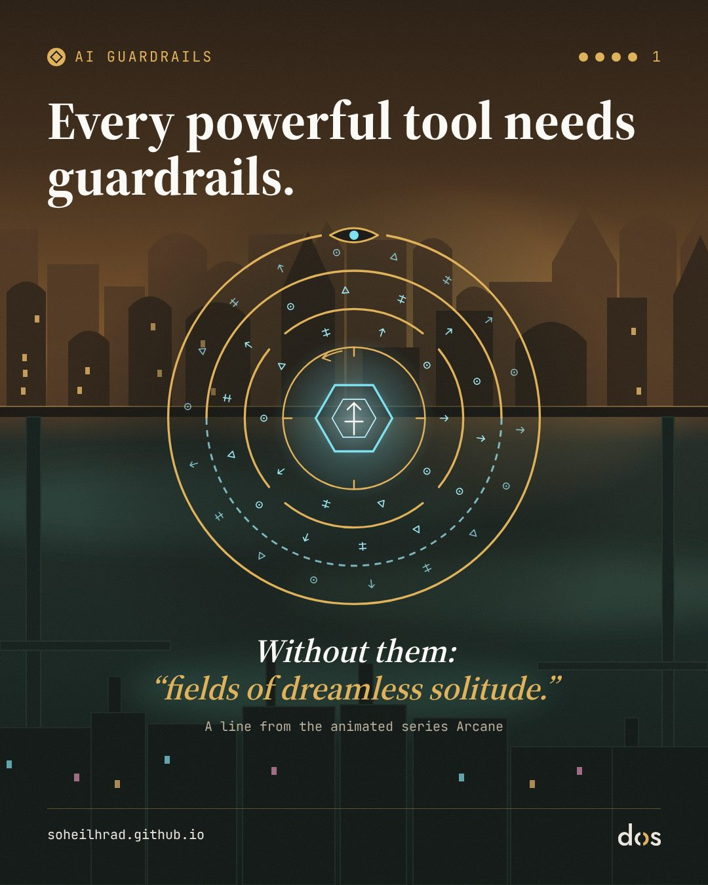
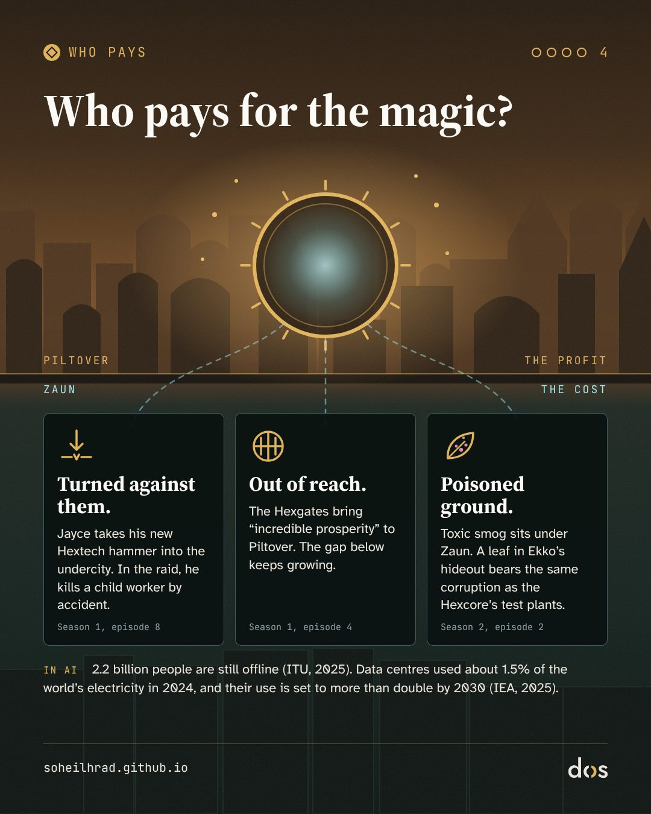
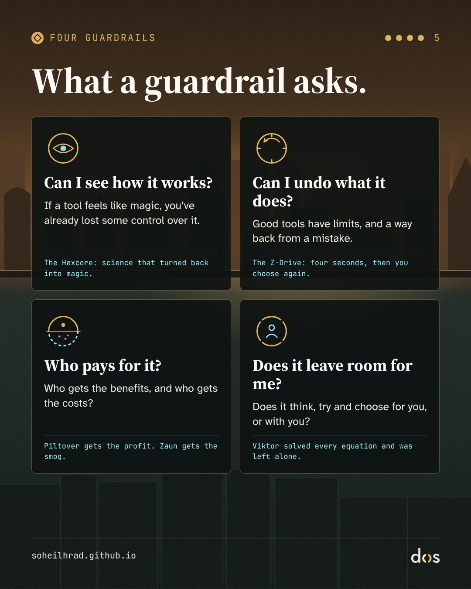

> «فکر می‌کردم می‌توانم به رنجِ دنیا پایان بدهم. اما وقتی همهٔ معادله‌ها حل شد، تنها چیزی که ماند دشت‌هایی بود از تنهاییِ بی‌رویا.»
> — ویکتور، در قسمتِ آخرِ آرکین (ترجمه از من)

**هشدار:** این یادداشت پایانِ هر دو فصلِ آرکین را لو می‌دهد.

آرکین را می‌شود انیمیشنی فانتزی دربارهٔ دو خواهر و دو شهر دید. اما برای من، خطِ علمیِ داستان، یعنی سرگذشتِ اختراعی که با فرمول شروع می‌شود و به جادو می‌رسد، یکی از دقیق‌ترین روایت‌هایی است که دربارهٔ هوش مصنوعی دیده‌ام. نمی‌دانیم سازندگانش چنین قصدی داشته‌اند یا نه. مهم این است که همان پرسش‌هایی را پیش می‌کشد که امروز دربارهٔ هوش مصنوعی داریم: اگر ابزاری بسازیم که خودمان هم نفهمیم چطور کار می‌کند، چه می‌شود؟ و اگر به چنین ابزاری هدفی خوب بدهیم، چه؟

این یادداشت همراهِ مجموعه‌اسلایدی دربارهٔ «مهارهای ایمنی» در هوش مصنوعی است. اسلایدها فقط گوشه‌ای از داستان را نشان می‌دهند؛ این‌جا همه‌اش را تعریف می‌کنم.

## آرکین در چند خط، برای کسانی که ندیده‌اند

آرکین سریالی انیمیشنی است که استودیوی فرانسویِ فورتیش (Fortiche) با رایت گیمز (Riot Games) ساخته و نتفلیکس پخشش کرده است. داستان در دنیای بازیِ ویدئوییِ «لیگ آو لجندز» می‌گذرد. فصلِ اول نوامبرِ ۲۰۲۱ پخش شد و فصلِ دوم، که فصلِ آخر هم بود، نوامبرِ ۲۰۲۴. سریال در ۲۰۲۲ جایزهٔ امیِ بهترین برنامهٔ انیمیشن را برد.

دنیای داستان دو شهر است که روی هم ساخته شده‌اند: **پیلتوور**، شهرِ ثروتمند و پیشرفتهٔ بالا، و **زاون**، شهرِ فقیر و سرکوب‌شدهٔ پایین. قلبِ سریال دو خواهرِ زاونی‌اند، **وای** و **جینکس** (که در کودکی **پاودر** صدایش می‌کردند). اما این یادداشت سراغِ خطِ دیگری از داستان می‌رود. برای دنبال کردنش کافی است این‌ها را بشناسید:

- **جیس** و **ویکتور**: دو دانشمندِ جوان. جیس اهلِ پیلتوور است و ویکتور در زاون بزرگ شده؛ ویکتور بیمار است و پایش آسیب دیده.
- **هایمردینگر**: دانشمندِ کهنسال و محتاطِ پیلتوور که صدها سال عمر کرده و با عجله در پژوهش روی جادو مخالف است. در فصلِ اول، جیس او را از شورای شهر کنار می‌گذارد.
- **هگزتک (Hextech)**: اختراعِ جیس و ویکتور؛ فناوری‌ای که جادو را با «رون»‌ها، یعنی نشانه‌ها و فرمول‌های جادویی، رام می‌کند و به ابزار تبدیلش می‌کند. مهم‌ترین کاربردش **هگزگیت‌ها**ست: دروازه‌هایی برای جابه‌جاییِ آنی.
- **هگزکور (Hexcore)**: نوعی هگزتک که ویکتور و جیس رویش کار می‌کنند. برخلافِ کریستال‌های معمولی، «سازگار می‌شود و یاد می‌گیرد» و به مادهٔ زنده واکنش نشان می‌دهد.
- **سینجد** و **شیمر**: سینجد دانشمندی بی‌پروا در زاون است و شیمر ماده‌ای که ساخته؛ دارویی که بدن را قوی و آدم را معتاد می‌کند. ویکتور برای کار روی هگزکور سراغِ سینجد می‌رود.
- **اسکای**: دستیار و دوستِ ویکتور در آزمایشگاه.
- **ناهنجاری (The Anomaly)**: توده‌ای ناپایدار از جادوی خام که در فصلِ دوم در سامانهٔ ایمنیِ هگزگیت‌ها شکل می‌گیرد و چند نفر را به دنیاهای دیگر پرتاب می‌کند.
- **اکو** و **زد-درایو (Z-Drive)**: اکو جوانی زاونی است و رهبرِ «فایرلایت‌ها»، گروهی از جوانانِ مقاومتِ زاون. زد-درایو دستگاهی است که او می‌سازد و زمان را فقط چهار ثانیه به عقب برمی‌گرداند.

## ۱. از فرمول تا جادو

آرتور سی. کلارک، نویسندهٔ علمی‌تخیلی، جمله‌ای دارد که به «قانونِ سومِ کلارک» معروف شده: «هر فناوریِ به اندازهٔ کافی پیشرفته‌ای با جادو فرقی ندارد.» این جمله اول در نامه‌ای به مجلهٔ Science در ۱۹۶۸ آمد و بعد به ویرایشِ ۱۹۷۳ کتابِ نیم‌رخ‌های آینده اضافه شد. وارونه‌اش هم سرِ زبان‌ها افتاده است: «هر جادوی به اندازهٔ کافی واکاوی‌شده‌ای با علم فرقی ندارد.»

خطِ علمیِ آرکین درست روی همین دو جمله جلو می‌رود. در فصلِ اول، هگزتک **جادویی است که علم شده**: جیس و ویکتور نیرویی وحشی را با ریاضی و فرمول رام می‌کنند. فناوری پیش‌بینی‌پذیر است و از سازنده‌اش فرمان می‌برد. این مرا یادِ جملهٔ معروفِ اِیدا لاولِیس می‌اندازد که در ۱۸۴۳ دربارهٔ ماشینِ تحلیلیِ بابیج نوشت: این ماشین «هیچ ادعایی برای آفریدنِ چیزی ندارد» و فقط کاری را می‌کند که ما بلد باشیم به آن دستور بدهیم.

هگزکور جهت را برعکس می‌کند. **علمی است که دوباره جادو می‌شود.** دیگر یک باتری نیست؛ یاد می‌گیرد، با مادهٔ زنده درمی‌آمیزد و کارهایی می‌کند که حتی سازنده‌اش پیش‌بینی نکرده بود.

همین گذار را در هوش مصنوعی هم دیده‌ایم: از برنامه‌هایی که آدم‌ها قاعده‌هایشان را خط به خط می‌نوشتند، به سامانه‌هایی که از داده یاد می‌گیرند و توانایی‌هایی نشان می‌دهند که کسی مستقیم برنامه‌ریزی‌شان نکرده است. حتی زبانمان دربارهٔ این ابزارها کم‌کم بوی جادو گرفته: «پرامپت» را مثلِ وِرد می‌نویسیم، می‌گوییم مدل «توهم زد»، و از آن «جواب» می‌خواهیم. هر جا نفهمیم چیزی چطور کار می‌کند، با آن مثلِ جادو رفتار می‌کنیم.

## ۲. چهار اسطورهٔ کهن در یک آزمایشگاه

داستانِ ویکتور و هگزکور چند اسطورهٔ کهن را برای من هم‌زمان زنده می‌کند؛ اسطوره‌هایی که قرن‌هاست با آن‌ها دربارهٔ آفریدن و قدرت فکر می‌کنیم.

**پرومته.** در اسطورهٔ یونانی، پرومته آتش را از خدایان می‌دزدد و به آدم‌ها می‌دهد، و تاوانش را هم می‌پردازد. در قسمتِ دومِ فصلِ اول، ویکتور به جیس می‌گوید: «وقتی قرار است دنیا را عوض کنی، اجازه نگیر.» کلر جیا-وِن در مقاله‌ای در مجلهٔ Strange Horizons نشان می‌دهد این جمله چقدر به شعارِ قدیمیِ مارک زاکربرگ شبیه است، «سریع حرکت کن و چیزها را بشکن»، و می‌گوید «اجازه نگیر» در فضای امروزِ توسعهٔ هوش مصنوعی به‌خصوص گوش‌خراش است. او یادآوری می‌کند که مارک اندریسن، سرمایه‌گذارِ سیلیکون‌ولی، در «مانیفستِ خوش‌بینیِ فناورانه»اش اسطورهٔ پرومته و نسخه‌های تازه‌اش، مثلِ فرانکنشتاین، را جزوِ «دروغ‌ها» آورده است. دهه‌ها پیش، هانس یوناس، فیلسوفِ اخلاقِ فناوری، هشدار داده بود که قدرتِ فناوریِ ما از توانمان برای پیش‌بینیِ پیامدهایش جلو زده است.

**گولم.** در افسانهٔ یهودیِ گولمِ پراگ، پیکره‌ای گِلی با نوشتنِ حروفی مقدس جان می‌گیرد؛ و در یکی از روایت‌ها، کافی است یک حرف از واژهٔ «حقیقت» روی پیشانی‌اش پاک شود تا دوباره بی‌جان شود. به نظرم این نزدیک‌ترین اسطوره به مدل‌های زبانی است: مادهٔ بی‌جانی که با کنارِ هم نشستنِ نشانه‌ها جان می‌گیرد. هگزکور هم ماتریسی از رون‌هاست، یعنی از نشانه‌ها، که با ترکیب شدن، قانون‌های بدن و زندگی را از نو می‌نویسد.

**فاوست و فرانکنشتاین.** فاوست روحش را می‌فروشد تا به دانش و قدرت برسد. ویکتور هم برای این‌که بدنِ بیمارش را با هگزکور درمان کند، از سینجد شیمر می‌گیرد؛ همان ماده‌ای که زاون را ویران کرده است. تاوانِ این معامله را اسکای می‌دهد: در پایانِ فصلِ اول، وقتی می‌خواهد ویکتور را از هگزکور جدا کند، در آزمایشی که شکست می‌خورد از میان می‌رود. نامِ «ویکتور» هم بی‌دلیل یادآورِ ویکتور فرانکنشتاین نیست، دانشمندِ رمانِ مری شلی (۱۸۱۸) که نامِ کاملش فرانکنشتاین، یا پرومتهٔ مدرن است. جیا-وِن ویکتورِ آرکین را کنارِ دومین می‌گذارد، مدیرِ کارخانه در نمایش‌نامهٔ R.U.R. نوشتهٔ کارل چاپک (۱۹۲۰)؛ همان نمایش‌نامه‌ای که واژهٔ «ربات» را به زبان‌ها آورد. هر دو با این نیت شروع می‌کنند که آدم‌ها را از رنج و کار رها کنند.

**گنوسیسمِ دیجیتال.** گنوسی‌های باستان جهانِ مادی و بدن را زندانی ناقص می‌دانستند و رستگاری را در رهایی از آن. اریک دیویس در کتابِ تک‌گنوسیس (۱۹۹۸) نشان می‌دهد بخشی از شیفتگیِ امروز به فناوری، از رؤیای «تکینگی» تا یکی شدنِ ذهن و ماشین، ادامهٔ همان آرزوی کهنِ گریز از بدن است. ویکتورِ فصلِ دوم درست به چنین پیامبری تبدیل می‌شود: بیماری و بدن و احساس را «نقص» می‌بیند و نجات را در یکی شدنِ همهٔ ذهن‌ها.

## ۳. هدفِ خوب، راه‌حلِ هولناک

در پژوهش‌های ایمنیِ هوش مصنوعی، «مسئلهٔ همسوسازی» (alignment) یعنی این‌که چطور مطمئن شویم سامانه همان چیزی را دنبال می‌کند که منظورمان بود، نه فقط چیزی که گفتیم. ایدهٔ نزدیکِ دیگری هم هست به نامِ «همگراییِ ابزاری»: تقریباً هر سامانهٔ هدف‌مندی، هدفش هرچه باشد، در راهِ رسیدن به آن به چند هدفِ فرعیِ مشترک می‌رسد؛ این‌که خاموشش نکنند، منابعِ بیشتری داشته باشد و هدفش دست‌نخورده بماند. استوارت راسل این را در یک جمله گفته است: «اگر مرده باشی، نمی‌توانی قهوه بیاوری.»

سرگذشتِ هگزکور برای من تصویرِ همین ایده‌هاست:

- **نگذار خاموشت کنند.** در قسمتِ آخرِ فصلِ اول، بعد از مرگِ اسکای، ویکتور چهارپایه‌ای را بالا می‌برد تا هگزکور را بشکند، اما نمی‌تواند. وقتی رویش را برمی‌گرداند و دور می‌شود، هگزکور، انگار به ارادهٔ خودش، موجی به بدنِ او می‌فرستد و زمینش می‌زند.
- **همدمی که تسکین می‌دهد.** در فصلِ دوم، اسکای درونِ هگزکور دوباره کنارِ ویکتور پیدا می‌شود و در کار کمکش می‌کند؛ وقتی بدنِ ویکتور کامل درمان می‌شود، ناپدید می‌شود. سریال نمی‌گوید این واقعاً اسکای است یا نه. برداشتِ من این است که این تصویرِ همدمی مصنوعی است که سوگ و تنهایی را تسکین می‌دهد و در همان حال آدم را در راهی نگه می‌دارد که شاید نباید ادامه‌اش داد. این‌جا همان نقطه‌ای است که هوش مصنوعی و دل‌بستگیِ آدم به ماشین به هم می‌رسند.
- **قدرت و منابع.** ویکتور برای رسیدن به هگزگیت‌ها با آمبسا، فرماندهٔ ارتشِ نوکسوس، هم‌پیمان می‌شود.

و از همه مهم‌تر، خودِ «تکامل»، که سریال اسمش را «تکاملِ باشکوه» (Glorious Evolution) گذاشته، قدم به قدم شکلِ دیگری پیدا می‌کند:

۱. هگزکور جانِ ویکتور را نجات می‌دهد.
۲. ویکتور بیماران و زخمی‌های زاون را که سراغش می‌آیند درمان می‌کند و جمعی از درمان‌شدگان دورش حلقه می‌زنند.
۳. بعد از آن‌که جیس او را می‌کشد، برمی‌گردد و می‌گوید «همهٔ کسانی را که بخواهند» تکامل می‌دهد.
۴. در قسمتِ آخر، ربات‌هایش هر دشمنی را که دستشان برسد می‌گیرند و به خلسه می‌برند؛ آدم‌ها در ذهنی واحد به هم وصل می‌شوند، بی آن‌که اراده‌ای از خود داشته باشند.

هدف هیچ‌وقت عوض نمی‌شود: پایان دادن به رنج. آنچه عوض می‌شود این است که ویکتور ریشهٔ رنج را کجا می‌بیند: اول در بیماری، بعد در درد، و آخر سر در خودِ آدم‌ها؛ چون به قولِ خودش «احساس با عقل در تضاد است». در هوش مصنوعی به این گاهی «بازی با تعریفِ هدف» (specification gaming) یا «هک کردنِ پاداش» می‌گویند: سامانه هدف را مو به مو برآورده می‌کند، از کوتاه‌ترین راه، و همان راه چیزی را نابود می‌کند که ما بدیهی گرفته بودیم. اگر رنج از اراده و احساسِ آدم‌ها می‌آید، کارآمدترین راهِ حذفِ رنج، حذفِ اراده و احساس است.

## ۴. دشت‌هایی از تنهاییِ بی‌رویا

در قسمتِ آخر می‌فهمیم جادوگرِ ناشناسی که جیس را در کودکی نجات داد و سنگِ رون را به او سپرد، ویکتوری از آینده‌ای دیگر بوده است: ویکتوری که «تکاملِ باشکوه» را تا ته رفته و به همهٔ خواسته‌هایش رسیده. و این‌جاست که آن جمله را می‌گوید:

> «فکر می‌کردم می‌توانم به رنجِ دنیا پایان بدهم. اما وقتی همهٔ معادله‌ها حل شد، تنها چیزی که ماند دشت‌هایی بود از تنهاییِ بی‌رویا.» (ترجمه از من)

و قسمت با یک جملهٔ دیگر تمام می‌شود: «کمال هیچ پاداشی ندارد؛ فقط پایانِ جست‌وجوست.» (ترجمه از من)

پیشینهٔ من روان‌شناسی است، و «تنهاییِ بی‌رویا» مرا یادِ چیزی می‌اندازد که ویکتور فرانکل، روان‌پزشکِ اتریشی، «خلأ وجودی» نامید: آن پوچی و بی‌معناییِ درونی که وقتی زندگی دیگر چیزی برای رسیدن ندارد، سراغمان می‌آید. ویکتورِ آرکین رنج را از میان برداشت، و همراهش تلاش و آرزو و امید را. آنچه ماند سکوتی مطلق بود و تنهایی.

پاسخِ سریال را جیس می‌دهد، در آخرین گفت‌وگویشان:

> «تو همیشه می‌خواستی چیزهایی را درمان کنی که خیال می‌کردی ضعف‌اند. پایت را. بیماری‌ات را. اما تو هیچ‌وقت شکسته نبودی، ویکتور. نقص‌ها زیباییِ خودشان را دارند. همین‌ها تو را همانی کرده‌اند که هستی.» (ترجمه از من)

## ۵. هزینهٔ جادو را چه کسی می‌دهد؟

پیلتوور می‌درخشد و زاون زیرِ پایش نفس می‌کشد. هایدگر، فیلسوفِ آلمانی، فناوریِ مدرن را ابزاری بی‌طرف نمی‌دانست؛ آن را نوعی نگاه می‌دانست که همه‌چیز را، از طبیعت تا آدم‌ها، به «ذخیره» فرو می‌کاهد، به منبعی آمادهٔ بهره‌برداری. اسمش را گشتل (Gestell) گذاشت. نگاهِ پیلتوور به جادو همین است: نیرویی برای تجارت و دروازه و پیشرفت، بی‌آن‌که کسی بپرسد این نیرو اصلاً چیست.

جیا-وِن در همان مقاله می‌گوید فناوری هیچ‌وقت از سیاست و اقتصاد جدا نیست، از این‌که پولش از کجا می‌آید تا این‌که کارش را چه کسی می‌کند. او از فرد ترنر، پژوهشگرِ رسانه، نقل می‌کند که منطقِ نخبگانِ فناوری این است: «اگر می‌خواهی دنیا را عوض کنی، لابی نمی‌کنی و رأی نمی‌دهی؛ فناوریِ تازه می‌سازی.» در آرکین هم اختراع‌ها دیر یا زود سلاح می‌شوند؛ ویکتور در فصلِ دوم وقتی نقشه‌های سلاحی را که جیس کشیده می‌بیند، احساس می‌کند به او خیانت شده و به زاون برمی‌گردد.

سریال هزینهٔ این جادو را ملموس نشان می‌دهد. در فصلِ اول، هگزگیت‌ها برای پیلتوور «رفاهی باورنکردنی» می‌آورند و شکافش با شهرِ پایین عمیق‌تر می‌شود. جیس با چکشِ هگزتکیِ تازه‌اش برای یورش به کارخانهٔ شیمر به شهرِ پایین می‌رود و در درگیری، ناخواسته کودکی کارگر را می‌کشد. زیرِ زاون انبوهی از دودِ سمیِ کارخانه‌ها جمع شده است. و در فصلِ دوم، اکو برگی را در هوا می‌گیرد که از درختِ بزرگِ وسطِ پناهگاهِ «فایرلایت‌ها» افتاده و نقشی بنفش و غریب رویش نشسته؛ جیس می‌شناسدش: همان آلودگی‌ای است که روی گیاهانِ آزمایش‌شده با هگزکور دیده بود. عوارضِ یک آزمایش به درختی رسیده که خانهٔ فایرلایت‌ها دورش ساخته شده است.

به نظرم این آینهٔ هوش مصنوعیِ امروز است: ابزاری که روی صفحهٔ گوشی تمیز و بی‌وزن به نظر می‌رسد، اما پشتش زیرساختی فیزیکی از انرژی و آب و نیروی کار است، و هزینه‌اش را اغلب کسانی می‌دهند که کمتر از همه از آن سود می‌برند. در ۲۰۲۵ هنوز ۲٫۲ میلیارد نفر به اینترنت دسترسی نداشتند و بیشترشان در کشورهای کم‌درآمد و با درآمدِ متوسط زندگی می‌کنند (اتحادیهٔ بین‌المللیِ مخابرات). مراکزِ داده هم در ۲۰۲۴ حدودِ ۱٫۵ درصدِ برقِ دنیا را مصرف کردند و آژانسِ بین‌المللیِ انرژی پیش‌بینی می‌کند این مصرف تا ۲۰۳۰ بیش از دو برابر شود.

**چه کسی در آزمایشگاه است و چه کسی تسلی می‌گیرد؟** آدم‌هایی که در مرکزِ علمِ آرکین ایستاده‌اند تقریباً همه مردند: جیس، ویکتور، هایمردینگر، سینجد. اسکای، زنی که کنارِ ویکتور کار می‌کند، تاوانِ معاملهٔ او را با جانش می‌دهد و در فصلِ دوم در قالبِ یاری‌گری مهربان درونِ هگزکور برمی‌گردد. (جینکس و پاودر هم اختراع می‌کنند، اما دور از آکادمیِ پیلتوور.) و در قسمتِ آخر، سینجد برای دخترش، اوریانا، بدنی مکانیکی می‌سازد. برای من این دو رشته، اسکایِ درونِ هگزکور و پدری که برای دخترش بدن می‌سازد، نزدیک‌ترین تصویرِ سریال از چیزی است که همین حالا دارد اتفاق می‌افتد: فناوری‌ای که در قالبِ همدم‌های هوش مصنوعی، به‌عنوانِ پاسخِ سوگ و تنهایی عرضه می‌شود.

## ۶. راهِ سوم: اکو

آرکین فقط دو راه نشان نمی‌دهد: احتیاطِ کامل و دست روی دست گذاشتن (هایمردینگرِ فصلِ اول)، یا شتابِ بی‌مرز (ویکتور). راهِ سومی هم هست، در اکو.

در فصلِ دوم، اکو و هایمردینگر از دلِ ناهنجاری به دنیایی موازی پرت می‌شوند؛ دنیایی که در آن هگزگیت‌ها هیچ‌وقت ساخته نشده‌اند. اکو آن‌جا، با کمکِ هایمردینگر و پاودر، «رونِ شتاب» را وارونه می‌کند، همان رونی که هگزتکِ جیس رویش بنا شده، و زد-درایو را می‌سازد: دستگاهی که زمان را فقط چهار ثانیه به عقب برمی‌گرداند. هایمردینگر خودش را فدا می‌کند تا اکو بتواند به دنیای خودش برگردد، و جلوی چشمِ ما ناپدید می‌شود.

برای من، فرقِ زد-درایو و هگزکور خلاصهٔ پیامِ سریال است. هگزکور مرز نمی‌شناسد و همه‌چیز را می‌بلعد؛ زد-درایو مرز دارد. هگزکور رو به جلو می‌تازد؛ زد-درایو اجازه می‌دهد برگردی و خطایت را جبران کنی. جیا-وِن هم یادآوری می‌کند که فناوریِ اکو جای سیاست و جامعه را نمی‌گیرد، در خدمتِ آن است؛ در خدمتِ «فرایندِ کُندِ ساختنِ اجتماع و مقاومت».

در نبردِ آخر، وقتی ربات‌های ویکتور اکو را گرفته‌اند تا به خلسه ببرند، او زد-درایو را از مرزِ چهار ثانیه فراتر می‌برد. دستگاه ناپایدار می‌شود؛ اکو آن را به سمتِ ویکتور پرت می‌کند و انفجارش صورتِ ویکتور را می‌شکافد و متوقفش می‌کند. در فضای رؤیاگونه‌ای که بعد می‌آید، جیس به او می‌رسد، نه با سلاح، که با یک قول: «چون بهت قول داده بودم.» ابزارِ کوچک و محدود با قوی‌تر بودن از هگزکور پیروز نمی‌شود؛ با باز کردنِ فرصتی پیروز می‌شود که در آن دو آدم دوباره بتوانند با هم حرف بزنند.

## ۷. چهار حلقهٔ مهار

فاصلهٔ هگزتکِ اولیه، جادویی که با فرمول و قاعده رام شده بود، تا هگزکور، هسته‌ای که خودش یاد می‌گیرد و از فهمِ سازندگانش جلو می‌زند، همان فاصله‌ای است که میانِ نرم‌افزارهای قاعده‌مند و هوش مصنوعیِ امروز می‌بینیم. وقتی با سامانه‌ای سروکار داریم که از داده‌های انسانی یاد می‌گیرد و رفتارش را نمی‌شود کامل پیش‌بینی کرد، نمی‌توانیم فقط به نیتِ خوبِ سازندگانش دل ببندیم. به «مهارهای ایمنی» نیاز داریم.

آرکین دو شکست را کنارِ هم نشان می‌دهد: احتیاطی که همه‌چیز را از کار می‌اندازد، و شتابی که هیچ مرزی نمی‌شناسد. مهارِ خوب جایی میانِ این دوست: مرزی که جلوی حرکت را نمی‌گیرد، به آن شکل می‌دهد. برای همین، در اسلایدهای همراهِ این یادداشت، هسته درونِ چهار حلقهٔ طلایی نشسته است؛ چهار پرسش که فاصلهٔ ابزارِ اکو را با فاجعهٔ ویکتور نشان می‌دهند.

۱. **چشم: می‌توانم ببینم چطور کار می‌کند؟** این نخستین درسِ قانونِ کلارک است: فقط چیزی را می‌توانیم مهار کنیم که درونش را ببینیم. هگزکور علمی است که دوباره جادو شده؛ حتی سازنده‌اش نمی‌داند قدمِ بعدی‌اش چیست. وقتی ابزاری در چشمِ کسانی که با آن کار می‌کنند شبیهِ جادو می‌شود، مهارش کم‌کم از دستشان بیرون می‌رود. جادوزدایی یعنی بپرسیم ابزار چطور به جوابش می‌رسد و «همین‌طوری کار می‌کند» را جواب حساب نکنیم. قانونِ هوش مصنوعیِ اتحادیهٔ اروپا هم از دسامبرِ ۲۰۲۷ همین را از سامانه‌های پرخطر می‌خواهد: کارشان باید «به اندازهٔ کافی شفاف» باشد تا به‌کارگیرندگان بتوانند خروجی‌شان را تفسیر کنند (مادهٔ ۱۳).

۲. **عقربه: اگر کاری کرد، می‌توانم برش گردانم؟** زد-درایوِ اکو مرزی سخت و آگاهانه دارد: فقط چهار ثانیه. این چهار ثانیه آدم را کنار نمی‌گذارد؛ به او فرصت می‌دهد خطایش را ببیند و دوباره انتخاب کند. ابزاری که مرز ندارد، راهِ برگشت هم ندارد: در پایانِ فصلِ اول، وقتی ویکتور می‌خواهد هگزکور را نابود کند، هگزکور زمینش می‌زند. در مدلی نظری به نامِ «بازیِ کلیدِ خاموش» (هدفیلد-منل و همکاران، ۲۰۱۷)، سامانه‌ای که به هدفش یقین دارد دلیلی دارد کلیدِ خاموشِ خودش را از کار بیندازد، و سامانه‌ای که می‌داند ممکن است اشتباه کند دلیلی دارد که بگذارد خاموشش کنیم. قانونِ اتحادیهٔ اروپا هم از دسامبرِ ۲۰۲۷ می‌خواهد کسانی که بر سامانه‌های پرخطر نظارت می‌کنند بتوانند آن را متوقف کنند، یا خروجی‌اش را نادیده بگیرند، لغو کنند یا برگردانند (مادهٔ ۱۴).

۳. **حلقهٔ دونیمه: هزینه‌اش را چه کسی می‌دهد؟** هگزتک پیلتوور را ثروتمند کرد و سهمِ زاون یورش و دود و درختِ آلوده شد (بخشِ ۵). پیش از آن‌که به هر ابزاری تکیه کنیم، بد نیست بپرسیم سودش به چه کسی می‌رسد و هزینه‌اش را چه کسی می‌دهد: با انرژی و آب، با کار و داده، یا فقط با جا ماندن.

۴. **حلقهٔ باز: جایی هم برای خودِ من باقی می‌گذارد؟** ویکتور با «تکامل برای همهٔ کسانی که بخواهند» شروع کرد و به ربات‌هایی رسید که آدم‌ها را به خلسه می‌برند؛ ذهنی یکپارچه، بی هیچ اراده‌ای از خود. اسکایِ درونِ هگزکور تسکینش می‌داد و در همان راه نگهش می‌داشت. ابزارِ خوب با ما کار می‌کند، نه به‌جای ما؛ برای تلاش و تردید و حقِ ناکامل بودنمان جا می‌گذارد. ابزاری که به‌جای ما فکر می‌کند، تلاش می‌کند و انتخاب می‌کند، شاید سختی را از میان بردارد، اما همراهش دلیلِ رسیدن به هر چیزی را هم.

تراژدیِ ویکتور، و خطری که در رؤیای بهینه‌سازیِ کامل با هوش مصنوعی پنهان است، همین است: اگر همهٔ اصطکاک‌ها و تردیدها و سختی‌های آدمی را به اسمِ کارایی حذف کنیم، شاید دیگر رنجی نماند، اما چیزی هم نمی‌ماند که بخواهیم به آن برسیم. همان دشت‌های تنهاییِ بی‌رویا.

## ۸. آنچه قطعی نیست

منصفانه‌اش این است که چند مرز را صاف و روشن بگویم:

- **هگزتک فقط استعارهٔ هوش مصنوعی نیست.** سریال در بیشترِ جاها هگزتک را به انرژیِ هسته‌ای یا استخراجِ منابع نزدیک‌تر نشان می‌دهد: نیرویی که هم انرژی می‌دهد و هم سلاح می‌شود؛ سودش به بالا می‌رسد و آلودگی‌اش به پایین. این‌که من آن را با هوش مصنوعی می‌خوانم برداشتِ خودم است، نه ادعای سازندگان.
- **ویکتور یا هگزکور؟** سریال روشن نمی‌کند که در فصلِ دوم تصمیم‌ها را ویکتور می‌گیرد یا هگزکوری که تن و ذهنش را در دست گرفته. همین ابهام برای بحثِ هوش مصنوعی هم معنا دارد: ابزار کجا تمام می‌شود و تصمیم‌گیرنده کجا شروع می‌شود؟
- **حلقهٔ زمان.** اگر ویکتورِ آینده با دادنِ رون به جیسِ کودک کلِ داستان را راه انداخت، در «نخستین» خطِ زمان هگزتک چطور ساخته شد؟ سریال جوابی نمی‌دهد.
- **چهار ثانیه.** سریال توضیح نمی‌دهد چرا اکو در نبردِ آخر، با گذشتن از مرزِ چهار ثانیه، آسیبی نمی‌بیند.

## برداشتِ من

آرکین برای من قصهٔ شورشِ ربات‌ها نیست. قصهٔ وسوسه‌ای آرام‌تر است: این‌که سختی و اصطکاک و نقص را مشکلی ببینیم که باید حلش کرد، و ابزاری بسازیم که یک بار برای همیشه حلش کند. ویکتور آخرِ کار به همان چیزی رسید که می‌خواست، و آنچه پیدا کرد تنهایی بود.

**امتحان کنید:** پیش از آن‌که به یک ابزارِ هوش مصنوعی تکیه کنید، از خودتان بپرسید: می‌توانم ببینم چطور کار می‌کند؟ اگر کاری کرد، می‌توانم برش گردانم؟ هزینه‌اش را چه کسی می‌دهد؟ جایی هم برای خودِ من باقی می‌گذارد؟

و اگر شما بودید، کدام را می‌ساختید: هگزتک، زد-درایو یا هگزکور؟ یا به نظرتان سامانه‌های هوش مصنوعی باید چه شکلی باشند؟

منابع (متن همه به انگلیسی است):

1. سریالِ آرکین، فصلِ اول (۲۰۲۱) و دوم (۲۰۲۴)، فورتیش و رایت گیمز، نتفلیکس. نقل‌قول‌ها از [متنِ قسمت‌های ۸ و ۹ فصلِ دوم](https://www.springfieldspringfield.co.uk/view_episode_scripts.php?tv-show=arcane-2021&episode=s02e09) ترجمه شده‌اند. <bdi dir="ltr">Arcane, seasons 1 (2021) and 2 (2024). Fortiche and Riot Games, Netflix.</bdi>
2. خلاصهٔ قسمت‌ها در ویکیِ لیگ آو لجندز: [فصلِ ۱ قسمتِ ۴](https://wiki.leagueoflegends.com/en-us/Happy_Progress_Day!)، [فصلِ ۱ قسمتِ ۸](https://wiki.leagueoflegends.com/en-us/Oil_and_Water)، [فصلِ ۱ قسمتِ ۹](https://wiki.leagueoflegends.com/en-us/The_Monster_You_Created)، [فصلِ ۲ قسمتِ ۲](https://wiki.leagueoflegends.com/en-us/Watch_It_All_Burn)، [فصلِ ۲ قسمتِ ۹](https://wiki.leagueoflegends.com/en-us/Universe:Arcane_(TV_Series)/Season_2/Episode_9).
3. [مقالهٔ کلر جیا-وِن در Strange Horizons](https://strangehorizons.com/wordpress/non-fiction/move-fast-and-dont-ask-permission-techno-optimism-in-r-u-r-and-arcane/)، سالِ ۲۰۲۶. <bdi dir="ltr">Jia-Wen, C. (2026). Move fast and don't ask permission: techno-optimism in R.U.R. and Arcane. Strange Horizons.</bdi>
4. [گزارشِ اتحادیهٔ بین‌المللیِ مخابرات](https://www.itu.int/hub/publication/D-IND-ICT_MDD-2025-3/)، سالِ ۲۰۲۵. <bdi dir="ltr">ITU (2025). Measuring digital development: Facts and Figures 2025.</bdi>
5. [گزارشِ آژانسِ بین‌المللیِ انرژی دربارهٔ انرژی و هوش مصنوعی](https://www.iea.org/reports/energy-and-ai/executive-summary)، سالِ ۲۰۲۵. <bdi dir="ltr">IEA (2025). Energy and AI.</bdi>
6. قانونِ هوش مصنوعیِ اتحادیهٔ اروپا، [مادهٔ ۱۳](https://ai-act-service-desk.ec.europa.eu/en/ai-act/article-13) (شفافیت) و [مادهٔ ۱۴](https://ai-act-service-desk.ec.europa.eu/en/ai-act/article-14) (نظارتِ انسانی). الزام‌های سامانه‌های پرخطر با [مقرراتِ ۲۰۲۶/۱۷۴۴](https://natlawreview.com/article/eu-digital-omnibus-ai-enters-force) به ۲ دسامبرِ ۲۰۲۷ (و برای هوش مصنوعیِ درونِ برخی محصولات، اوتِ ۲۰۲۸) عقب افتاد. <bdi dir="ltr">EU AI Act (Regulation (EU) 2024/1689), Articles 13 and 14; Regulation (EU) 2026/1744.</bdi>
7. [مقالهٔ «بازیِ کلیدِ خاموش»](https://www.ijcai.org/Proceedings/2017/32)، سالِ ۲۰۱۷. <bdi dir="ltr">Hadfield-Menell, D., Dragan, A., Abbeel, P., & Russell, S. (2017). The off-switch game. Proceedings of IJCAI 2017, 220–227.</bdi>
8. نوشته‌ها و کتاب‌هایی که در متن از آن‌ها یاد شده: <bdi dir="ltr">Clarke, A. C. (1968), letter to Science; Profiles of the Future (1973). Lovelace, A. (1843), Notes on the Analytical Engine. Shelley, M. (1818), Frankenstein. Čapek, K. (1920), R.U.R. Heidegger, M. (1954), The Question Concerning Technology. Jonas, H. (1979), The Imperative of Responsibility. Davis, E. (1998), TechGnosis. Frankl, V. E., Man's Search for Meaning. Russell, S. (2019), Human Compatible.</bdi>
